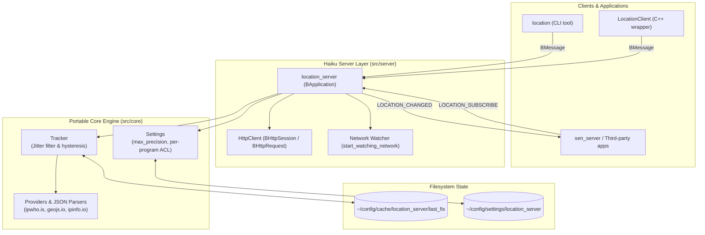

<!--
SPDX-License-Identifier: MIT
SPDX-FileCopyrightText: 2026 SEN Labs e.U.
-->
<p align="center">
  
</p>

# Basho (場所) — Ambient Location Service for Haiku

**Basho** is a lightweight, privacy-first background service for Haiku that provides rough geographic location to applications that ask.

Named after the Japanese word for *place* (and Matsuo Bashō, the wandering poet of haiku fame), Basho operates as a clean system daemon (`application/x-vnd.basho-location_server`) modeled after Haiku services like `notification_server`. It runs independently, maintains no custom BFS filesystem attributes, and communicates entirely via native Haiku `BMessage`s or the provided `LocationClient` C++ library.

---

## Table of Contents

1. [Why Basho? (For End Users)](#why-basho-for-end-users)
2. [Privacy & Security by Design](#privacy--security-by-design)
3. [User Experience & Settings](#user-experience--settings)
4. [Using the Command-Line Tool (`location`)](#using-the-command-line-tool-location)
5. [Configuration Reference](#configuration-reference)
6. [System Architecture & Inner Mechanics](#system-architecture--inner-mechanics)
7. [Developer Guide & Integration](#developer-guide--integration)
8. [Building, Testing, and Packaging](#building-testing-and-packaging)
9. [API Documentation & Pointers](#api-documentation--pointers)
10. [Status & Credits](#status--credits)

---

## Why Basho? (For End Users)

Modern desktop environments often require basic geographic awareness to be truly helpful:
* **Weather widgets** can immediately display the local forecast without asking you to type your city.
* **Clocks and calendars** can adapt to the current time zone when you travel.
* **Search and place lookups** (such as in SEN) can rank nearby results ahead of distant ones.
* **Spatial workspaces** can automatically suggest or activate regional desktop contexts (e.g., switching to a "Vienna" or "Berlin" context when your laptop connects to a local network).

Traditionally, users have had to manually configure their location in every separate application, or endure opaque background tracking. Basho provides a unified, unobtrusive middle ground: your desktop knows roughly which city and country it is in, shares that knowledge safely with authorized programs, and never compromises your privacy.

---

## Privacy & Security by Design

Basho was built with strict privacy guarantees:

* **Asks Before Connecting:** Basho never phones home silently. The first time network lookup is required, it presents an authorization dialog (*Not now* / *Never* / *Allow*) and persists your choice. If you choose *Never*, no network request is ever sent.
* **Rough, City-Level Awareness Only:** Basho uses public, keyless HTTPS IP geolocation services (`ipwho.is`, `geojs.io`, `ipinfo.io`). An IP address identifies a broad metropolitan region (accuracy between 5 and 50 km)—never a street address, house number, or personal coordinate. Your physical coordinates are never transmitted anywhere.
* **User-Defined Precision Caps (`max_precision`):** The server retains the best available fix internally, but only discloses what your privacy policy permits:
  * `city`: Full resolved city, region, country, and approximate coordinates.
  * `region`: Regional level (~100 km accuracy); city name is omitted.
  * `country`: Country code only; geographic coordinates and cities are completely omitted.
  * `<km>`: Snaps coordinates to a fixed radius (e.g., `50` km).
* **Grid-Snapped Coarsening:** Coarse positions are calculated from the center of fixed geographic grid cells rather than by adding random noise. This ensures that a program cannot triangulate your real location by collecting and averaging multiple readings over time.
* **Per-Application Permissions:** You can grant or restrict access for individual applications based on their Haiku application signature (e.g., granting `city` to a weather app, `country` to a localization helper, and `none` to an untrusted tool).
* **Selective Notifications:** Subscribers are only notified when the data *they are allowed to see* changes. If an application only requested country-level data, travelling between cities within that country will trigger no notifications.
* **Safe Offline Operation:** Basho caches the last confirmed location on disk (`~/config/cache/location_server/last_fix`). If you boot while offline, applications still receive an initial estimate flagged as `stale`, preventing false triggers.

---

## User Experience & Settings

### The First-Run Prompt
When an application first requests location data and Basho is in `ask` mode, a system alert appears asking if network geolocation is permitted. Your response is saved to `~/config/settings/location_server`.

### Graphical Preferences (SEN Settings Integration)
On systems with SEN installed, open the Deskbar menu and choose **Settings… › SEN › Location**. 

Powered by Shoji forms, this pane provides:
* A global toggle for network geolocation (`ask`, `allow`, `never`).
* **Show Location now:** a button under the toggle that looks the place up (if the lookup is allowed) and shows what the server found, with how and when, in the line below it: the same fix that a program that may know everything would get, so you can see what is told.
* A global precision limit (`city`, `region`, `country`, or custom radius).
* **Lookup services:** a table with a box for each service (ipwho.is, GeoJS, ipinfo, and ip-api, which answers over http only and is off unless you switch it on). They are asked in the order of the list; at least one stays on.
* **Application access** (a node below *Location*): the **Application Permissions Table:** A live table listing every program that has requested location access. Each entry lets you toggle permission on/off or configure an individual precision cap.

*(Basho implements SEN's replicant settings protocol; any compatible host can embed this configuration UI.)*

---

## Using the Command-Line Tool (`location`)

Basho includes a command-line utility, `location`, for querying status, testing privacy levels, and managing overrides.

### Querying Location
```sh
# Show current location (starts location_server if not running)
location

# Force a fresh lookup over the network
location get --force

# Request a specific granularity (city, region, country, or distance in km)
location get --granularity country

# Continuously monitor and print location changes
location watch
```

### Manual Overrides (For VPNs and Offline Use)
If you frequently use a VPN or prefer never to perform network lookups (`network_lookup never`), you can manually set a fixed location:
```sh
# Set a manual override (latitude longitude [city] [country])
location set 52.52 13.405 Berlin DE

# Clear manual override and revert to normal lookups
location clear
```

### Managing Configuration and Permissions
```sh
# View current settings, limits, and requesting applications
location config

# Set global maximum precision
location config set max_precision region

# Set a specific permission limit for an application
location grant application/x-vnd.sen-labs.sen_server city

# Inspect daemon internal state (providers, timestamps, status)
location status

# Terminate the background daemon
location quit
```

---

## Configuration Reference

Basho stores its configuration in plain text at:
```
~/config/settings/location_server
```

### Configuration Keys

| Setting | Values | Default | Description |
|---|---|---|---|
| `network_lookup` | `ask` \| `allow` \| `never` | `ask` | Network authorization state. `never` restricts Basho exclusively to manual overrides. |
| `max_precision` | `city` \| `region` \| `country` \| `<km>` | `city` | Global upper bound on precision provided to clients. |
| `providers` | List of URLs / names | `ipwho.is geojs.io ipinfo.io` | Order of keyless HTTPS geolocation services queried. |
| `interval_minutes` | Integer (e.g. `30`) | `30` | Interval between routine background lookups. |
| `min_refresh_seconds`| Integer (e.g. `60`) | `60` | Minimum throttle time between consecutive network requests. |
| `min_move_km` | Integer (e.g. `25`) | `25` | Distance threshold required before considering a coordinate shift a location change. |
| `confirmations` | Integer (e.g. `2`) | `2` | Number of consecutive matching fixes required to confirm a genuine move. |
| `program <sig> <lvl>`| Signature and level | *(none)* | Specific granularity limit for an app (`none`, `city`, `region`, `country`, `<km>`, `default`). |

---

## System Architecture & Inner Mechanics

Basho uses a modular architecture separating network retrieval, stabilization logic, and Haiku desktop integration.



### How Fixes are Discovered and Stabilized

1. **Triggering Lookups:**
   * **Periodic Timer:** Wakes every `interval_minutes` (default 30 min).
   * **Network Changes:** Listens to Haiku's network notifications (`start_watching_network`). Joining a new Wi-Fi network or plugging in Ethernet triggers a re-check after an 8-second debounce window.
   * **Client Refresh:** On-demand requests from applications (`LOCATION_FORCE_REFRESH` or `location get --force`), rate-limited to at most once per `min_refresh_seconds` (60s).
2. **Provider Failover:**
   * Queries HTTPS providers sequentially (`ipwho.is` → `geojs.io` → `ipinfo.io`) until one returns a valid response.
3. **Anti-Jitter Hysteresis:**
   * IP-based coordinates frequently jump between different routing endpoints. To prevent desktop applications from switching back and forth erratically, Basho requires **two consecutive matching fixes** before broadcasting a location change.
4. **Cache & Persistence:**
   * The confirmed fix is cached to disk so subsequent machine boots have an immediate starting position. Fixes older than two intervals are marked `stale`.

---

## Developer Guide & Integration

Applications can integrate with Basho either via the C++ `LocationClient` convenience library or directly using Haiku `BMessage`s.

### Option A: Using `LocationClient` (Recommended for C++)

`LocationClient` handles daemon discovery, auto-launching, and synchronous or asynchronous location queries.

```cpp
#include <location/LocationClient.h>

// 1. Asynchronous monitoring in a BHandler / BWindow
class WeatherView : public BView {
    LocationClient fLocationClient;

    void AttachedToWindow() override {
        // Subscribe to updates. Request only the granularity needed ("city", "region", "country")
        fLocationClient.StartWatching(BMessenger(this), "city");
    }

    void DetachedFromWindow() override {
        fLocationClient.StopWatching(BMessenger(this));
    }

    void MessageReceived(BMessage* message) override {
        switch (message->what) {
            case LOCATION_CHANGED: {
                BString city;
                double lat, lon;
                if (message->FindString("city", &city) == B_OK &&
                    message->FindDouble("latitude", &lat) == B_OK &&
                    message->FindDouble("longitude", &lon) == B_OK) {
                    UpdateWeather(city, lat, lon);
                }
                break;
            }
            default:
                BView::MessageReceived(message);
        }
    }
};

// 2. Synchronous one-shot lookup
LocationClient client;
double latitude, longitude;
BString city;
if (client.GetCurrentLocation(&latitude, &longitude, &city) == B_OK) {
    // Note: returns B_NOT_SUPPORTED if the user restricted access to "country"
}
```

### Option B: Native `BMessage` Protocol

For applications communicating directly without `liblocation.a`:

* **Server Signature:** `application/x-vnd.basho-location_server`
* **Request Commands:**
  * `LOCATION_SUBSCRIBE` (`'LCSB'`): Pass `target` (`BMessenger`, optional, defaults to sender) and `granularity` (`string`, optional). Immediately delivers the current fix followed by `LOCATION_CHANGED` on future updates.
  * `LOCATION_UNSUBSCRIBE` (`'LCUB'`): Unregister the messenger.
  * `LOCATION_GET_CURRENT` (`'LCGC'`): Synchronous lookup. Optional `force` (bool) and `granularity` (string). Replies with `LOCATION_CURRENT_REPLY` or `LOCATION_ERROR`.
  * `LOCATION_FORCE_REFRESH` (`'LCFR'`): Trigger an immediate background lookup.
  * `LOCATION_SET_OVERRIDE` (`'LCSO'`) / `LOCATION_CLEAR_OVERRIDE` (`'LCCO'`): Manage manual overrides.

### The Fix Payload Structure

The payload in `LOCATION_CHANGED` and `LOCATION_CURRENT_REPLY` contains:

| Field Name | Type | Notes |
|---|---|---|
| `latitude` | `B_DOUBLE_TYPE` | Decimal degrees, WGS 84. *(Omitted if granularity is `country`)* |
| `longitude` | `B_DOUBLE_TYPE` | Decimal degrees, WGS 84. *(Omitted if granularity is `country`)* |
| `accuracy` | `B_FLOAT_TYPE` | Estimated accuracy radius in metres (typically 5,000–50,000 m). |
| `city` | `B_STRING_TYPE` | Resolved city name (e.g. `"Vienna"`). *(Omitted at `region` and `country`)* |
| `region` | `B_STRING_TYPE` | State, province, or region name. *(Omitted at `country`)* |
| `country` | `B_STRING_TYPE` | ISO 3166-1 alpha-2 uppercase country code (e.g. `"AT"`, `"US"`). |
| `timezone` | `B_STRING_TYPE` | IANA time zone identifier (e.g. `"Europe/Vienna"`). |
| `timestamp` | `B_INT64_TYPE` | UNIX timestamp in seconds when the fix was recorded. |
| `provider` | `B_STRING_TYPE` | Source identifier (e.g. `"ipwho.is"` or `"manual"`). |
| `stale` | `B_BOOL_TYPE` | `true` if fix is older than two lookup intervals (offline start). |
| `manual` | `B_BOOL_TYPE` | `true` if this fix originated from a manual override. |
| `granularity` | `B_STRING_TYPE` | Active granularity level delivered (`city`, `region`, `country`, or km radius). |

### Best Practices for Developers
* **Ask for Minimal Granularity:** If your app only needs to choose a language or date format, request `"country"`. If you are showing weather, ask for `"city"`.
* **Handle Stale Fixes Responsibly:** Check the `stale` boolean. A stale fix is suitable for populating a default UI field, but should not trigger automated data migrations or irrevocable actions.
* **Respect Error Statuses:** Handle `B_NOT_ALLOWED` gracefully if the user has disabled location access or denied your application.

---

## Building, Testing, and Packaging

### Building on Haiku
```sh
# Compiles bin/location_server, bin/location, and lib/liblocation.a
./build.sh
```

### Running Tests
The core library has no Haiku dependencies and can be compiled and verified on macOS, Linux, and Haiku:
```sh
# Run portable core unit tests (parsers, hysteresis, grid snapping, settings)
sh tests/run.sh

# Run server integration tests inside a Haiku environment
sh tests/vm/server.sh
```

### Creating Haiku Packages (`.hpkg`)
```sh
# Generates basho-<version>.hpkg and basho_devel-<version>.hpkg
./package.sh
```
* The version string is declared authoritatively in `src/server/location_server.rdef`.

---

## API Documentation & Pointers

For in-depth protocol definitions, method signatures, and architectural design notes, refer directly to the source and documentation files:

* [include/location/Location.h](include/location/Location.h): The authoritative wire protocol definition, `BMessage` field constants, and error codes.
* [include/location/LocationClient.h](include/location/LocationClient.h): Complete C++ client API class documentation, method declarations, and synchronous/asynchronous usage semantics.
* [docs/design-notes.md](docs/design-notes.md): Detailed architectural design notes, analysis of IP geolocation trade-offs, jitter filter specifications, and proposed SEN spatial context integration.
* [src/core/Tracker.h](src/core/Tracker.h): Implementation of the 2-fix hysteresis anti-jitter engine and distance threshold evaluation.

---

## Status & Credits

### Project Status
* **Implemented:** Background daemon, C++ `LocationClient` library, `location` CLI tool, per-application permission ACLs, Shoji/SEN settings protocol node, and `.hpkg` packaging scripts.
* **Roadmap / Planned:** Launch-daemon activation job, Wi-Fi positioning integration (beaconDB), and GPS receiver support (NMEA serial/USB).

### Credits & Iconography
* **Server Icon (`images/basho-server.svg`):** Combines the *Hand* and *Globe* vector icons from Haiku, Inc. (licensed under MIT). Vector HVIF translation generated using `svg2hvif.py` from the [SEN](https://github.com/sen-laboratories/sento) project.
