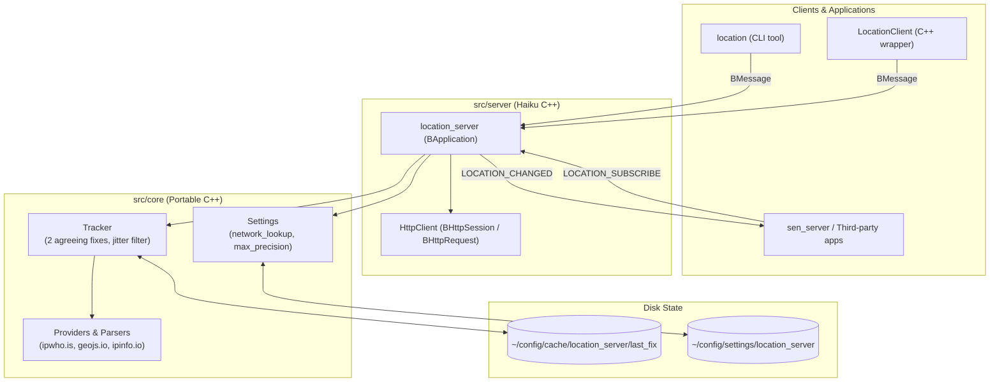

<!--
SPDX-License-Identifier: MIT
SPDX-FileCopyrightText: 2026 SEN Labs e.U.
-->
<p align="center">
  
</p>

# Basho (場所), the location server

A small background application for Haiku that knows roughly **where the machine is** and tells the programs that ask. It is a system service in the manner of `notification_server`:
nothing in it depends on SEN, it keeps no BFS attributes, and programs talk to it with `BMessage`s (or the `LocationClient` class). SEN uses it for contexts that follow the city you
are in, and for place lookups that prefer what is near you.

*Basho* is the Japanese word for *place*, and the name of the poet who wandered the country and made the haiku what it is. The signature is `application/x-vnd.basho-location_server`.

## What it does

* **Finds out where the machine is, roughly**: an IP geolocation lookup at a public service that needs no key (`ipwho.is`, `geojs.io`, `ipinfo.io`, all https; asked in this order until one
  answers). An IP address is placed to a city, not a street: the fix has an `accuracy` of 5 to 50 km, and it is sometimes the wrong city (a mobile network, a VPN). Programs must treat it as
  "which city, which country", never as "at this address".
* **Asks first.** A lookup sends the public address of the machine to a third party. The first time, the server shows one window (*Not now / Never / Allow*) and remembers the answer in
  `~/config/settings/location_server`. Nothing else is sent, and no position is ever sent anywhere.
* **Gives away only as much as the user allows.** The server keeps the finest fix it has, but programs are told what the setting `max_precision` allows: `city` (as looked up), `region`
  (no city, the position only to 100 km), `country` (no position at all) or a radius in km (`50`: the position is only known to 50 km, no city). A program can ask for less than that
  (`granularity` in the request: a weather applet wants a city, a program that picks the language wants a country), never for more, and the answer says which level it got. The coarse
  position is the middle of a cell of a fixed grid, not noise, so a program cannot average many answers to get the real one. A value in the setting that is not understood is the coarsest.
* **Knows who asks, and what each may know.** The limit can be set for single programs (`program <signature> <level>`; the level `none` gives a program nothing): the server finds the program
  by the signature of the application that sends the request, and keeps a list of the programs that have asked, so that the settings show them and a limit can be set for one before it
  gets its first answer. A change counts at once, also for programs that are subscribed already (they are told what they may be told now). This protects against programs that behave
  and against accidents; Haiku has no users and no sandbox to tell a program that lies about its signature from the real one.
* **Tells subscribers.** A program subscribes with `LOCATION_SUBSCRIBE` (or `LocationClient::StartWatching()`), gets the fix that the server has at once, and `LOCATION_CHANGED` when the
  place changes. A change is announced only when two lookups in a row agree on a new place (see `src/core/Tracker.h`): IP lookups jitter, and a program that switches something on every
  jitter is worse than none. And a subscriber is told only when *what it may be told* changes: a program that asked for the country does not hear of a move inside the country.
* **Looks again** every 30 minutes, when the network changes (a cable, a Wi-Fi that is joined), and when a program asks, but never more often than once a minute.
* **Remembers** the last fix (`~/config/cache/location_server/last_fix`) so that a machine that starts offline still has a guess; the fix is marked `stale` when it is older than two intervals.
* **Can be told** where it is (`LOCATION_SET_OVERRIDE`, `location set 52.52 13.405 Berlin DE`) for tests, for travelling with a VPN, and for people who do not want a lookup at all
  (`network_lookup never` in the settings, then only a position set by hand is used).

The protocol and the fields are in [include/location/Location.h](include/location/Location.h), the client class in [include/location/LocationClient.h](include/location/LocationClient.h).

## Use

```cpp
LocationClient client;                          // needs a BApplication; starts the server if it is not running
client.StartWatching(BMessenger(this), "city");  // LOCATION_CHANGED arrives in MessageReceived(): latitude, longitude, accuracy, city, region, country, timezone, provider, stale, granularity
                                                 // (ask for as little as you need: "city", "region", "country" or a number of km; the user's limit wins)

double latitude, longitude; BString city;
if (client.GetCurrentLocation(&latitude, &longitude, &city) == B_OK) ...
```

From the shell:

```sh
location                    # the fix (starts the server)
location get --force        # look up again first
location get --granularity country    # ask for less: city, region, country or a number of km
location watch              # print every change
location set 52.52 13.405 Berlin DE
location clear
location status
location config                   # the settings, and the programs that have asked
location config set max_precision region
location grant application/x-vnd.sen-labs.sen_server city     # what one program may know (city, region, country, none, <km>, default)
location quit
```

## Settings window

The settings (and the limits of the programs) are a message in the settings protocol of SEN: a host sends `LOCATION_SETTINGS` and gets the values, a schema (labels, choices, ranges) and the
defaults, and sends changed fields back with `LOCATION_SETTINGS_SET`. The settings window of **SEN** (Deskbar menu, *Settings…*) has a node **SEN › Location** when Basho is installed, with
the form of Shoji; the programs that have asked are **a table** (the array `programs` with `kind = table` in the schema): a row for each, a check box for whether it may know where the computer is at all,
and a menu of the finest level it may know (a click on a cell puts the control that edits it in its place). Anything else that speaks the protocol (the form of Shoji is a replicant that any program can host) can
show the same. Without SEN, `location config` and `location grant` do the same from the shell, and `~/config/settings/location_server` is a text file.

## Build and test (on Haiku)

```sh
./build.sh                    # bin/location_server, bin/location, lib/liblocation.a
sh tests/run.sh               # the portable core: parsers, fallback, change tracking, settings (also runs on macOS and Linux: JSON_INCLUDE=<folder with nlohmann/>)
sh tests/vm/server.sh         # the server through the tool (the lookup needs the network; NO_NETWORK=1 leaves it out; keeps and restores your settings)
./package.sh                  # basho-<version>.hpkg (the server in servers/, the command in bin/) and basho_devel-<version>.hpkg (headers, liblocation.a)
```

The version is that of `src/server/location_server.rdef` (and nowhere else). CI builds on Linux, macOS and a Haiku VM and keeps the packages as an artifact.

## How it is built



| Folder | What |
|---|---|
| `src/core` | **portable C++** (no Haiku headers): the fix, the providers and their parsers, the fallback, the change tracker, the settings. Unit-tested on the Mac. |
| `src/server` | the server (`BApplication`), the messages, and `HttpClient.cpp`: the HTTP of Haiku (`BHttpSession`/`BHttpRequest`, the way the HTTP classes of SEN do it), with SEN's socket client as the fallback if its header is installed |
| `src/client` | `LocationClient` |
| `src/tools` | the command `location` |

Another system (Hokku) needs its own `HttpClient.cpp` and the transport of the messages; the core is the same.

## Settings

`~/config/settings/location_server` (written with the defaults at the first start): `network_lookup ask|allow|never`, `max_precision city|region|country|<km>`, `providers`, `interval_minutes`,
`min_move_km`, `confirmations`, `min_refresh_seconds`. The file is read when the server starts (`location quit`, the next call starts it again). The server is started with `--allow-network` to allow the lookup for one run without writing anything (the tests use it).

## Credits

The icon of the server (`images/basho-server.svg`) combines the **Hand** and the **Globe** icons of Haiku, Inc. (MIT license): the world, served. It is made into the vector icon of the program by
`svg2hvif.py` of [SEN](https://github.com/sen-laboratories/sento/tree/1.0-sophia/tools).

## Status

A prototype. Done: the server, the client, the tool, per-program limits, the settings protocol and its node in the settings window of SEN, packages. Not done: a launch-daemon job (the client starts the
server when it is needed), Wi-Fi positioning (beaconDB), GPS, a window that shows who has asked for what and when, the use of the location by SEN (contexts, places: see [docs/design-notes.md](docs/design-notes.md)).
