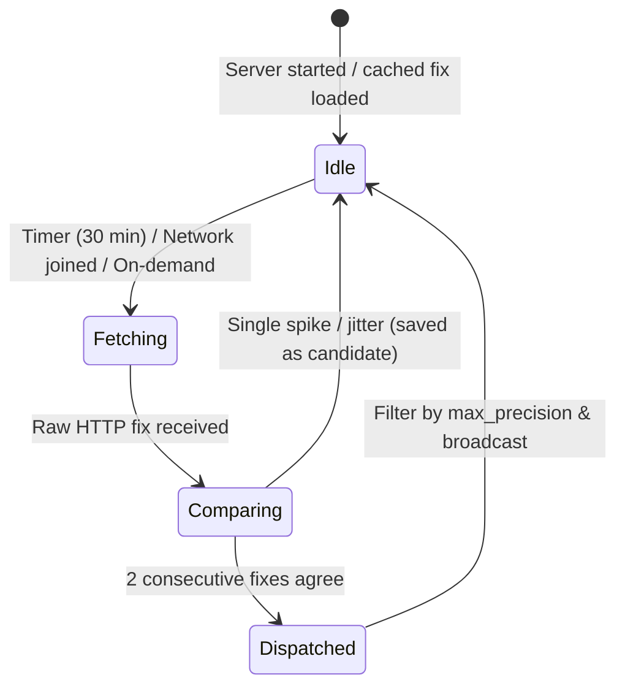

<!--
SPDX-License-Identifier: MIT
SPDX-FileCopyrightText: 2026 SEN Labs e.U.
-->
# Basho: notes on the spec, and what SEN does with it

The spec is `basho-location-service.md` (next to the SEN repositories). The prototype follows it. This file says where it does not, and why, and what is open.

## What the prototype keeps

A background server, no BFS attributes, `BMessage` pub/sub, the subscribe-gets-the-cached-fix-at-once behaviour, a pluggable list of providers, an override for tests, a client class. The protocol
constants and the field names of the spec are unchanged; fields were added, none was taken away.

## Where it differs from the spec

| Spec | Prototype | Why |
|---|---|---|
| zero configuration, the first lookup is silent | **asks once** (*Not now / Never / Allow*), stored in `~/config/settings/location_server`; `network_lookup never` | an IP lookup tells a third party the public address and, with it, the town. SEN does not send positions anywhere without the user's say (SUESS: *Use GPS location*). The asking is the one thing that makes the zero-configuration start honest |
| `ip-api.com` as the keyless default | `ipwho.is`, `geojs.io`, `ipinfo.io` (all https), asked in turn until one answers; `ip-api` only if named | the free plan of ip-api is **http only** (the answer can be read and changed on the way) and for non-commercial use. In a test today `ipapi.co` answered 429 on the first request and `freeipapi.com` redirected, so a list with a fallback is needed anyway |
| a change is announced when the coordinates "drift beyond a threshold or the city changes" | **a change needs two lookups in a row that agree**, and is compared by distance and country, never by name | different services place the same address in different districts and spell the city differently ("Wien", "Vienna"); a mobile network or a VPN can put the machine in another city for one lookup. Without this a context would switch back and forth. The announced fix is not replaced by a nearby one, so the name stays. 96 checks in `tests/CoreTest.cpp` |
| polling every 15 to 30 minutes | 30 minutes **and** a change of the network (`start_watching_network`, debounced by 8 s), and never more than once in `min_refresh_seconds` (60) | a new network is the moment the place changes; a timer alone notices it half an hour later or never |
| in-memory only | in memory, plus the **last fix in a text file in the cache folder** (still no BFS attributes), marked `stale` when it is older than two intervals; a stale fix is replaced by the first fresh one without a confirmation | a machine that starts offline should still have a guess. A subscriber must be able to tell a guess from a fix: it must not switch anything on a stale one |
| libcurl or sockets "for portability" | **BHttpSession / BHttpRequest** (the network kit), the way the HTTP classes of SEN do it, with SEN's socket client as the fallback for the Haiku bug with empty header values if its header is installed | decided: same HTTP everywhere in SEN. The portable part (`src/core`) takes an `HttpGet` function, so the tests run on the Mac without a network, and Hokku needs only its own `HttpClient.cpp` |
| signature `application/x-vnd.Haiku-location_server` | `application/x-vnd.basho-location_server` | `Haiku-` is the vendor of the Haiku project. If Haiku adopts it, the name is a rename away |
| `LOCATION_GET_CURRENT` and `LOCATION_FORCE_REFRESH` both force | `GET_CURRENT` with `force` waits for the lookup and answers with the result; `FORCE_REFRESH` is "look again, tell the subscribers"; both obey the rate limit | one is a question, the other a nudge |
| nothing about how fine the location may be | **`max_precision`** (`city` / `region` / `country` / km) caps what programs are told; a request can carry a coarser `granularity`; the answer says the level it got; the coarse position is a grid cell, not noise; a subscriber is told only when what it may be told changes; a setting that is not understood is the coarsest | the API is open to every program, and the user decides how much of the location any of them gets. The finest fix stays inside the server. **Per program limits** (a level for each signature, found from the team of the sender with the roster; `none` refuses the program) replace the general one for that program, live; the signature can be claimed by any program, so this is a courtesy contract with programs that behave, not a sandbox |
| | `LOCATION_GET_STATUS`, fields `timezone`, `stale`, `manual` | for the tool, for contexts (the time zone is free with every provider), for telling an override from a lookup |

The spec has two backronyms for Basho. The second one (*Background Ambient Spatial Haiku Observer*) says what the program is; the first is about boundaries, which it does not do.

## What an IP address can and cannot tell

Cities, not streets: the answers are 5 to 50 km off, sometimes in the wrong city, rarely in the wrong country. So the fix is good for **which city and which country** and for "is the
machine where it was". It is not good for "is the user at the office", and no feature should pretend that. The `accuracy` field is there so that a consumer can refuse a fix that is too
coarse for it. Better sources can come behind the same interface without a change of the protocol: Wi-Fi positioning (beaconDB, no key; it sends the access points around, which is more
than an address, so it would be its own question to the user) and a GPS receiver (NMEA over a serial or USB device).

## Not in the prototype

A window that shows who has asked for what and when. A launch-daemon job (the client starts the server on demand with the roster; a user who wants it from the boot needs a job file), a package, a Shoji form for the settings (the file is
text and commented), Wi-Fi positioning and GPS, a test on Hokku, and the use by SEN. Also not done: **who may override**. Any program can send `LOCATION_SET_OVERRIDE`; on a single-user
Haiku that is acceptable, but the fix says `manual`, and a consumer that cares can refuse one.

## What SEN does with it (a proposal, nothing of it is built)

**1. Contexts that follow the city.** A context is a file; a place is a file with a bounding box (`SEN:boxSouth/North/West/East`, indexed) and an outline. The binding is a relation from the
context to a Place (the *located near* relation of SEN Spatial, or an Association): "Vienna" is the context of the Place *Vienna*. On `LOCATION_CHANGED` the SEN server

* takes the fix (never a `stale` one, never one whose `accuracy` is larger than the place),
* queries the places whose box contains the point (one indexed attribute, the rest in code, as `sen_spatial` already does for *contains*),
* takes the contexts that are bound to them, the smallest place first,
* and, as a setting of *SEN › Core* (`off` / `suggest` / `switch`; default **suggest**), shows a notification, "You seem to be in Vienna: switch to the context *Vienna*?", or switches.

A context without a place can say where it is by itself (`SEN:contextRegion`: a point and a radius), which is enough for "Travel to Berlin". The *current* context is sticky and everything that is made
while it is current joins it (beta 5): that is why the default must be a suggestion. A context that switches itself on a wrong IP lookup would put the wrong files into the wrong
project.

**2. Places that are found where you are.** The enricher (SUESS) ranks the answers of a search by the distance to the position of the file, and uses no position that is not the file's.
With Basho it can use the **fix of the machine as the position of a file that has none**, only for the ranking and only on the machine: nothing is sent, so there is nothing new to ask. A
*Westbahnhof* without a city then comes out as the one in Vienna for a user who is in Vienna, and the one in Budapest for a user who is in Budapest, with the other still in the list. The `country`
of the fix could also be the soft default of the search when the file names none, but that would send the country (a little), so it should be a setting, off by default.

**3. Smaller things that follow:** the time zone for dates that have none, a place made at the current position (*New › Spatial › Here*), and *Nearby* with no place selected.
